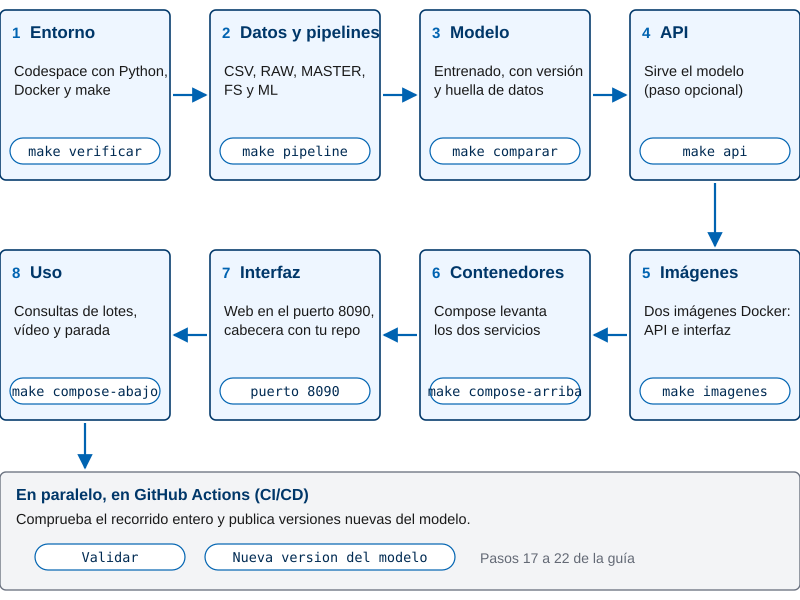

# Taller de punta a punta: calidad del café (CQI)

De un modelo de ML a un servicio en producción, con un caso real: dado un lote de café al recibirlo (origen, variedad,
beneficio y análisis del grano verde), antes de catarlo, **¿qué probabilidad hay de que alcance el grado de especialidad
(80 puntos o más)?** Los datos son los del Coffee Quality Institute (CQI).

El proyecto llega **completo**: datos, pipelines, cuadernos, API, interfaz, Dockerfiles, Compose y workflows de GitHub
Actions. **No hay que programar nada.** Este taller es de perfil **arquitecto**: se trata de desplegarlo de punta a punta,
ver que funciona y poder explicar **qué decisión de arquitectura hay detrás de cada pieza** y qué riesgo cubre.

Guía paso a paso (dónde ejecutar, qué orden, qué debes ver, qué hacer si falla): [taller/guia-detallada.md](taller/guia-detallada.md).
El enunciado de la tarea (qué entregas y cómo se evalúa) está en [taller/instrucciones.md](taller/instrucciones.md) y, resumido en un PDF
con diagramas, los pasos, los criterios de evaluación y el checklist, en `taller/instrucciones-del-taller.pdf`. La guía completa, con las
capturas de ejemplo, también está en PDF: `taller/guia-detallada.pdf`.



## La cadena completa

```
 CSV de CQI ──► base operacional ──► RAW ──► MASTER ──► FS ──► ML ──► modelo ──► API ──► interfaz
 (data/raw)     (cqi.db: simula      copia   dato      variables  conjunto  (MLflow)  (FastAPI) (web)
                el laboratorio)      fiel    depurado  del lote   y partición                       │
                                                                                                     ▼
                                     imágenes Docker ──► Compose (dos contenedores) ──► GitHub Actions
```

Cada flecha es una pieza que se puede ejecutar, probar y sustituir por separado; el porqué está en los documentos de
[docs/](docs/modelo-de-datos.md).

## Mapa del proyecto

| Carpeta o archivo | Qué hay y por qué está ahí |
|---|---|
| `data/raw/cqi/` | Los dos CSV de CQI (arábica y robusta), copia exacta de la fuente, con `SHA256SUMS` para comprobar que no cambiaron ni un byte. |
| `data/external/` · `data/processed/` | **Generadas**: la base operacional `cqi.db` y la analítica `cafe.db` (RAW, MASTER, FS, ML). No se versionan: se regeneran. |
| `sql/` | El SQL de cada capa (`operacional`, `raw`, `master`, `fs`, `ml`): crea y puebla. La lógica de datos vive aquí, legible. |
| `cafe_mlops/` | El paquete Python: pipelines, reglas de calidad, entrenamiento (`modeling/`), API (`api/`) e interfaz (`interfaz/`). |
| `notebooks/` | Cinco cuadernos ya ejecutados (00 a 04) que explican, celda a celda, lo que hace el paquete. Ver [docs/de-notebook-a-python.md](docs/de-notebook-a-python.md). |
| `models/` | El modelo entrenado (formato MLflow con su firma), `metadatos.json` y `referencia.json` (la versión aprobada contra la que se compara). Lo demás se genera. |
| `reports/` | Métricas del entrenamiento (`metricas.json`). Generada. |
| `deploy/docker/` | `Dockerfile` (API), `interfaz.Dockerfile` y `compose.yaml` (los dos servicios juntos). |
| `.github/workflows/` | `validar.yml` (comprueba todo el recorrido con Docker real) y `nueva-version.yml` (reentrena, compara, construye y publica una versión nueva). |
| `.devcontainer/` | El Codespace: Python 3.11, Docker dentro de Docker, puertos reenviados. |
| `tests/` | Las pruebas (`make test-rapido`). Vigilan, entre otras cosas, que ninguna nota de cata se cuele como variable. |
| `docs/` | Documentación técnica (abajo). |
| `evidencias/` | **Tu entrega**: `capturas/` del proceso de despliegue y `video/` del servicio funcionando por la interfaz. |
| `references/` | Fuente y licencia de los datos. |

## Documentación técnica

| Documento | Responde a |
|---|---|
| [docs/modelo-de-datos.md](docs/modelo-de-datos.md) | Qué capas hay (operacional, RAW, MASTER, FS, ML), qué contiene cada una y por qué no se salta ninguna. |
| [docs/de-notebook-a-python.md](docs/de-notebook-a-python.md) | Cómo se pasa del cuaderno de exploración a un paquete que se puede probar, repetir y desplegar. |
| [docs/api-y-contenedor.md](docs/api-y-contenedor.md) | El contrato de la API, sus errores, y qué lleva y qué no lleva cada imagen. |
| [docs/del-ordenador-al-servicio.md](docs/del-ordenador-al-servicio.md) | De dos procesos en tu equipo a dos contenedores con Compose, y qué falta para producción real. |

## El recorrido de despliegue, en 10 líneas

Desde la raíz del repositorio (en un Codespace hay `make`; en Windows ejecuta la línea `python -m ...` que hay debajo de
cada orden en el `Makefile`). El detalle de cada paso, con lo que debes ver, está en la [guía](taller/guia-detallada.md).

1. `make verificar` — el entorno está listo (Python 3.11, paquetes exactos, datos íntegros, Docker).
2. `make pipeline` — crea la base operacional, ejecuta RAW, MASTER, FS y ML, y entrena el modelo.
3. `make pipeline` otra vez — dice «sin cambios»: los pipelines son idempotentes.
4. `make mlflow` — abre MLflow (puerto 5000) y comprueba qué versión del modelo quedó registrada; `Ctrl+C` para cerrarlo.
5. `make api` sirve el modelo como proceso (puerto 8080, documentación en `/docs`); en otra terminal, `make interfaz` abre la web (puerto 8090).
6. `make comparar URL=http://127.0.0.1:8080` — comprueba que el paquete, el archivo, MLflow y la API dan la misma probabilidad.
7. Para los dos procesos (`Ctrl+C`) y ejecuta `make imagenes`: construye `cafe-api:local` y `cafe-interfaz:local`.
8. `make compose-arriba` — arranca los dos contenedores y espera a que estén sanos; la interfaz queda en el puerto 8090.
9. Abre la interfaz, consulta lotes y graba el vídeo; después `make compose-abajo` lo para todo.
10. `make pipeline HASTA=2018` — llegan lotes nuevos: se rehace todo y aparece una versión 2 del modelo.

`make ayuda` lista todas las órdenes. Pruebas rápidas: `make test-rapido`; completas, con cuadernos: `make test`.

## Datos

CSV limpios de `jldbc/coffee-quality-database` (licencia MIT en ese repositorio), con atribución en
[references/fuente.md](references/fuente.md). Las condiciones de uso de los datos del CQI están **sin verificar**.
Los CSV incluyen nombres y contactos que ya son públicos en la fuente: **nunca** se usan como variables del modelo
(una prueba lo vigila) y MASTER ni siquiera los lleva.
