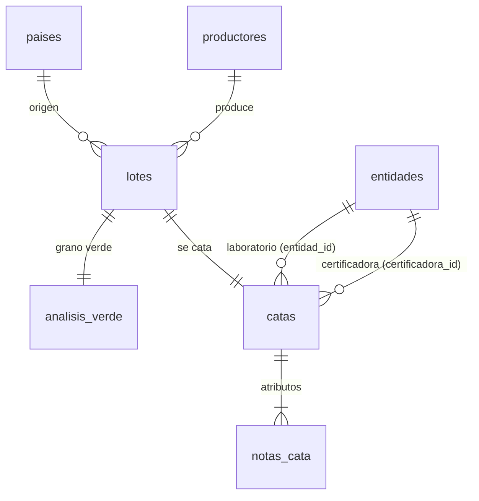
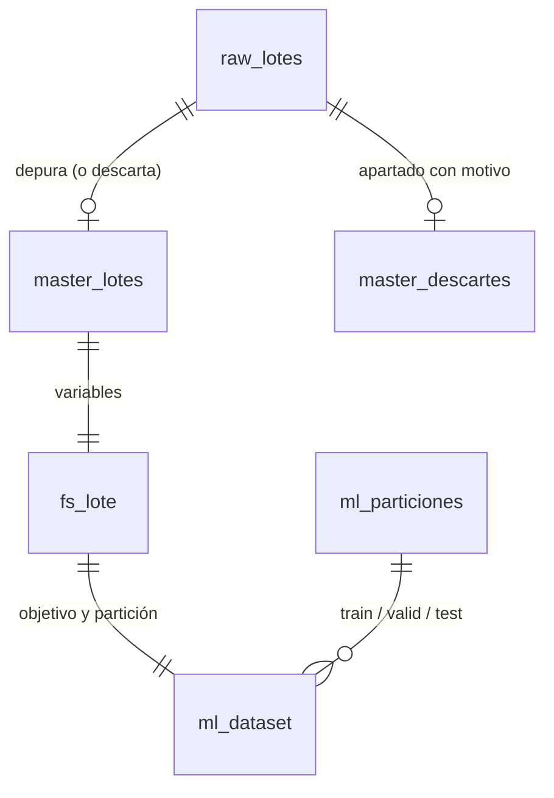

# Modelo de datos: de la base operacional al conjunto de modelado

Perfil de arquitecto: este documento explica **qué capas hay, qué contiene cada una y por qué no se salta ninguna**.
El SQL de cada capa está en `sql/<capa>/` y lo ejecutan los pipelines de `cafe_mlops/`.

## Las capas

```
 data/raw/cqi/*.csv
        │  make operacional        (simula el sistema del laboratorio)
        ▼
 OPERACIONAL  data/external/cqi.db     normalizada, con claves; conserva la suciedad del origen
        │  make raw                (pipeline_ingesta_raw)
        ▼
 RAW          data/processed/cafe.db   copia fiel, sin claves, con linaje (raw_carga)
        │  make master             (pipeline_ingesta_master)
        ▼
 MASTER       master_lotes             dato depurado, una fila por lote catado + reglas de calidad
        │  make ml                 (pipeline_ml)
        ▼
 FS           fs_lote, fs_catalogo     variables del lote (solo lo conocido AL RECIBIRLO)
        ▼
 ML           ml_dataset               FS + objetivo y + partición temporal
        │  make train              (pipeline_train)
        ▼
 modelo       models/modelo_mlflow
```

| Capa | Tablas | Qué decisión de arquitectura encierra |
|---|---|---|
| OPERACIONAL | `paises`, `entidades`, `productores`, `lotes`, `analisis_verde`, `catas`, `notas_cata`, `origen_simulacion` | Los CSV son una exportación plana; un sistema real guarda el dato normalizado. Se reconstruye ese modelo para que el pipeline **ingiera desde una base**, como en producción. El pipeline la lee y nunca escribe en ella. |
| RAW | `raw_paises`, `raw_entidades`, `raw_productores`, `raw_lotes`, `raw_analisis_verde`, `raw_catas`, `raw_notas_cata`, `raw_carga` | Copia fiel, sin claves ni validaciones: si el origen trae un problema, RAW lo conserva. Así siempre se puede reconstruir MASTER sin volver al origen y se sabe qué llegó (`raw_carga`: tabla, filas y huella sha256). |
| MASTER | `master_lotes`, `master_descartes`, `master_calidad`, `master_parametros` | Aquí se decide qué es dato válido. Cada corrección es una regla visible (altitud fuera de 100–4 000 m pasa a nulo, humedad 0 se trata como «no medido», las catas con total 0 se descartan con su motivo). **No lleva nombres de personas ni las diez notas de cata**: lo que no existe no se puede usar por descuido. |
| FS | `fs_lote`, `fs_catalogo` | Las variables se calculan una vez y se documentan (descripción, origen, cuándo se conocen). Regla de oro: **toda variable se conoce al recibir el lote, antes de catarlo**. |
| ML | `ml_dataset`, `ml_particiones`, `ml_parametros` | Une variables, objetivo `y` (1 si `Total.Cup.Points >= 80`) y la partición temporal. Es lo único que mira el resultado de la cata, y es correcto: es lo que el modelo debe anticipar. |

## Diagrama entidad-relación

Base operacional (cardinalidades tomadas de `sql/operacional/01_crear_operacional.sql`):



Capas analíticas (en `cafe.db`), unidas por `lote_id`:



Lo mismo en ASCII, por si el visor no dibuja mermaid:

```
paises 1──0..n lotes 1──1 analisis_verde          raw_lotes ──► master_lotes ──► fs_lote ──► ml_dataset
productores 1──0..n lotes 1──1 catas 1──10 notas   (lo que no pasa) master_descartes        ml_particiones 1──n ml_dataset
entidades 1──0..n catas (laboratorio y certificadora)
```

## Por qué estas decisiones

- **Una tabla RAW por tabla de origen y sin restricciones.** RAW no juzga; MASTER sí. Separarlo hace que una regla
  nueva de limpieza no obligue a pedir otra vez el dato al origen.
- **MASTER y FS se pueden borrar y regenerar por completo.** Nada se edita a mano: el estado es función de RAW y del código.
  La conciliación es una regla dura: `raw_lotes = master_lotes + master_descartes`.
- **Reglas de calidad de tres tipos** (`cafe_mlops/calidad.py`): *duro* detiene el pipeline, *alerta* se registra y sigue,
  *info* solo informa. El resultado queda con fecha en `master_calidad`: es la evidencia de que el dato se revisó.
- **Fuga de información (leakage).** Las diez notas de cata **suman** `Total.Cup.Points`; usarlas como variables sería
  «sumar», no predecir, y además no existen al recibir el lote. Una prueba (`tests/test_fs_y_ml.py`) la vigila en columnas,
  catálogo y SQL de FS.
- **Valores ausentes = NULL, no «Desconocida».** El modelo los imputa por dentro, igual en entrenamiento y en la API.
- **Partición temporal y deslizante**, por año de la cata, nunca aleatoria ni por orden de fila (el archivo viene ordenado
  por puntuación). En producción se entrena con el pasado y se predice lo que llega. Versión 1 de los datos
  (`--hasta 2016`): train hasta 2014, valid 2015, test 2016. Versión 2 (`--hasta 2018`): train hasta 2015, valid 2016,
  test 2017–2018. Con la versión 1 salen 866 lotes de train, 197 de valid y 127 de test (`models/referencia.json`).
  Los cortes son **provisionales** (decisión del coordinador, no del instructor).
- **Ventana común para comparar versiones.** Como valid cambia entre versiones, su AUC no es comparable; por eso la
  comparación con `models/referencia.json` usa el año 2016 (`config.VENTANA_COMUN`), que ninguna de las dos versiones vio al entrenar.
- **Idempotencia por huella de entrada** (`cafe_mlops/control.py`): cada pipeline calcula la huella de lo que lee, del
  SQL y de la configuración; si coincide con la última ejecución correcta, dice «sin cambios». Es lo que hace seguro
  relanzarlos y evita acumular versiones repetidas del modelo en MLflow.
- **Datos nuevos = cambiar el origen, no el código.** `make pipeline HASTA=2018` recrea la operacional con las catas
  hasta 2018; las huellas cambian y se rehace todo lo que depende de ello.

## Dónde mirar

- Estructura de cada tabla: `sql/<capa>/01_crear_*.sql`.
- Reglas de calidad y su resultado: `cafe_mlops/calidad.py` y la tabla `master_calidad`.
- Variables y su catálogo: `cafe_mlops/config.py` (`FEATURES`) y la tabla `fs_catalogo`.
- Cuadernos que lo recorren con salidas: `notebooks/00` a `03` (ver [de-notebook-a-python.md](de-notebook-a-python.md)).
