# Guía detallada: desplegar el modelo de punta a punta

Tarea Curso Taller «De Modelo de ML/IA a Producción». Esta guía es el paso a paso completo. Qué entregas y cómo se evalúa
está en [instrucciones.md](instrucciones.md); los criterios de evaluación, en [criterios-de-evaluacion.md](criterios-de-evaluacion.md);
la lista de comprobación, en [checklist.md](checklist.md).

No programas nada. El proyecto llega completo. Tu trabajo es desplegarlo: verificar el entorno, ejecutar los pipelines,
obtener el modelo, construir las imágenes, levantar los contenedores, abrir la interfaz y consumir el modelo. Después explicas
las decisiones de arquitectura que hay detrás de cada pieza. Por eso cada paso termina con una frase de decisión de arquitectura:
qué pieza es y qué riesgo cubre. En tu entrega la explicas con tus palabras.

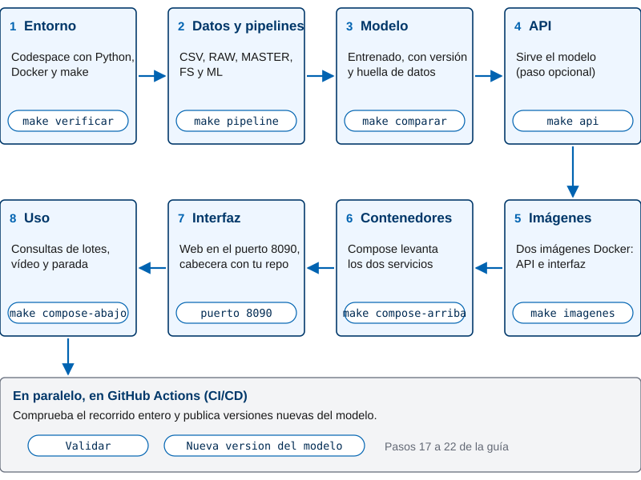

## Cómo leer cada paso

Cada paso tiene estos apartados, siempre en el mismo orden:

- Dónde: el sitio donde lo haces, el navegador (GitHub) o la terminal del Codespace.
- Comando: lo que copias y pegas, tal cual. Una orden cada vez, y lees lo que sale antes de seguir.
- Qué debes ver: la salida esperada, con su origen: una ejecución real en un Codespace (con su captura de ejemplo), en Windows o en GitHub Actions.
- Si falla: los fallos que ya se encontraron al probarlo de verdad y qué hacer.
- Evidencia: la captura que guardas en `evidencias/capturas/`, con su nombre.
- Decisión de arquitectura: la pieza y el riesgo que cubre.

Las capturas de ejemplo de esta guía (`docs/img/cs-taller-01.webp` a `cs-taller-10.webp`) son del repositorio de prueba del instructor, y en
ellas aparecen su usuario de GitHub y el nombre de su repositorio. En las tuyas aparecerán tu usuario y tu
repositorio `taller-ml-ia-dev-production`, y eso es lo que se espera ver.

## Qué se probó y qué no

Esta guía se escribió después de recorrer los pasos de verdad. Para que sepas cuánto fiarte de cada parte:

| Parte | Estado |
|---|---|
| Codespace creado desde el repositorio de prueba (preparación, `make verificar`, `make pipeline`, `make imagenes`, `make compose-arriba`, interfaz por el puerto 8090) | **Probado** en un Codespace real de 2 núcleos (tiempos y capturas de esta guía). |
| Workflows `Validar` y `Nueva version del modelo` (rechazada y aprobada con `tolerancia` 0,10, con aprobación manual del environment `produccion`) | **Probados** en GitHub Actions, en el repositorio de prueba del instructor. |
| Salidas de los pipelines, de `comparar`, de la API y de la interfaz | **Capturadas** ejecutándolas en Windows, sin Docker (`taller/salidas-reales.json`). |
| Descarga anónima del manifiesto de las imágenes publicadas en GHCR (el repositorio de prueba es público) | **Probada** (respuesta HTTP 200). |
| Crear el fork, renombrarlo, habilitar Actions en un fork, crear el environment y activar el permiso de pull requests en **tu** cuenta | **Sin verificar**: el repositorio de prueba no era un fork y se configuró desde la cuenta del instructor. Los pasos describen lo que hace GitHub, pero sus pantallas cambian con el tiempo. |
| Un recorrido completo con la cuenta de otro alumno | **Sin verificar** (queda para el ensayo de alumno). |
| Los cuadernos de `notebooks/` con su kernel en el Codespace | **Sin verificar** (se ejecutan con éxito en pruebas automáticas, no en el Codespace). No hacen falta para la tarea. |
| MLflow UI en el puerto 5000 (`make mlflow`) | **Sin verificar** en el Codespace. Es opcional. |
| `make api`, `make interfaz` y `make comparar URL=...` dentro del Codespace | **Sin verificar** allí (probados en Windows). |
| `docker pull` de las imágenes desde GHCR en un Codespace | **Sin verificar**. |
| `make pipeline HASTA=2018` y la segunda ejecución de `make pipeline` dentro del Codespace | **Sin verificar** allí (probadas en Windows). |
| Grabar el vídeo, comprimirlo y subir archivos grandes al fork | **Sin verificar** (la guía de grabación da el método, no una prueba). |
| Fusionar el pull request que abre `Nueva version del modelo` y ver `Validar` sobre él | **Sin verificar**. |

## Tiempos medidos

| Qué | Cuánto | Dónde se midió |
|---|---|---|
| Preparar el Codespace (crear y construir) | unos 4,5 min | Codespace real |
| `make pipeline` (los cuatro pipelines y el entrenamiento) | 49 s | Codespace real |
| `make imagenes` (con la caché de capas vacía) | 1 min 18 s | Codespace real |
| `make compose-arriba` | 13 s | Codespace real |
| Workflow `Validar` | 7 min 42 s | GitHub Actions |
| `Nueva version del modelo`, rechazada | 1 min 34 s | GitHub Actions |
| `Nueva version del modelo`, aprobada | 4 min 30 s (más lo que tardes en aprobar) | GitHub Actions |

Son tiempos de una sola prueba: los tuyos variarán. No hay todavía un cronometraje con alumnos (sin verificar).

---

## Paso 0 · Antes de empezar

**Dónde:** tu ordenador.

**Qué necesitas:**

- Una cuenta de GitHub con acceso a **Codespaces** y a **GitHub Actions**.
- Un navegador actual. Todo lo demás (Python, Docker, `make`) ya está dentro del Codespace: **no instalas nada en tu equipo**.
- Una forma de grabar la pantalla con tu voz (ver [guia-grabacion-video.md](guia-grabacion-video.md)).
- Tiempo seguido: los pasos 5 a 15 se hacen en una sesión; los pasos de GitHub Actions (17 a 22) esperan a que terminen los workflows.

**Si falla:** si no ves Codespaces en tu cuenta o se agota la cuota gratuita, no hay otra ruta probada en este taller: consúltalo
con el instructor antes de la fecha de entrega. La cuota concreta de tu cuenta está sin verificar aquí.

**Decisión de arquitectura:** el entorno entero vive en la nube y se describe en archivos (`.devcontainer/`). Cubre el riesgo
clásico de «en mi máquina funciona»: todos parten del mismo Python 3.11 y del mismo Docker.

---

## Paso 1 · Hacer el fork de la plantilla

**Dónde:** navegador, en GitHub, con tu sesión iniciada.

**Qué haces:** abre la plantilla `https://github.com/helicr/curso-ml-ia-desarrollo-produccion-tarea` y pulsa **Fork** (arriba a
la derecha), o abre directamente `https://github.com/helicr/curso-ml-ia-desarrollo-produccion-tarea/fork`. Elige tu cuenta
personal como propietario. En el formulario puedes escribir ya el nombre `taller-ml-ia-dev-production` (si no lo haces ahora,
lo cambias en el paso 2). Deja marcada la opción de copiar solo la rama `main`. Pulsa **Create fork**.

**Qué debes ver:** tu nuevo repositorio `<tu-usuario>/<nombre>` con, bajo el título, el texto «forked from helicr/curso-ml-ia-desarrollo-produccion-tarea».
Un fork de un repositorio público **conserva el vínculo** con el original y es **público** también.

**Si falla:** si ya tenías un fork de esa plantilla, GitHub te lleva a él en lugar de crear otro: renómbralo (paso 2). No uses «Use this template»:
el enunciado pide un fork.

**Decisión de arquitectura:** el fork es tu copia del sistema completo (código, datos, pipelines, Dockerfiles, workflows).
Todo lo que despliegas queda versionado y atribuible a tu cuenta. Cubre el riesgo de un despliegue que dependa de algo que
solo existe en una máquina o que nadie puede reproducir.

---

## Paso 2 · Renombrar el fork a `taller-ml-ia-dev-production`

**Dónde:** navegador, en tu fork: pestaña **Settings** > **General** > campo **Repository name**.

**Qué haces:** escribe exactamente `taller-ml-ia-dev-production` y pulsa **Rename**. El instructor te identifica por ese nombre
y por el enlace, así que no añadas nada más.

**Qué debes ver:** la dirección `https://github.com/<tu-usuario>/taller-ml-ia-dev-production`.

**Si falla:** si GitHub dice que ese nombre ya existe en tu cuenta, tienes otro repositorio con ese nombre: renómbralo o bórralo.
Comprueba también que el repositorio sea **público** (en Settings, al final, «Danger Zone»). Un fork de un repositorio público lo es.

**Evidencia (captura `01-fork-renombrado`):** la página principal de tu repositorio con el nombre `taller-ml-ia-dev-production` y la
línea «forked from ...» visibles.

**Decisión de arquitectura:** una convención de nombres estable es lo que permite identificar y automatizar. Cubre el riesgo de
una entrega que nadie sabe de quién es ni dónde está.

---

## Paso 3 · Crear el Codespace

**Dónde:** navegador, en tu fork.

**Qué haces:** botón verde **Code** > pestaña **Codespaces** > **Create codespace on main**. Si te deja elegir máquina, usa la de **2 núcleos**
(la que se probó; el proyecto pide al menos 2).

**Qué debes ver:** se abre una ventana de VS Code en el navegador. Durante unos 4,5 minutos verás abajo a la derecha el mensaje
«Setting up remote connection: Building codespace...» y la barra de estado azul «Abriendo remoto...».

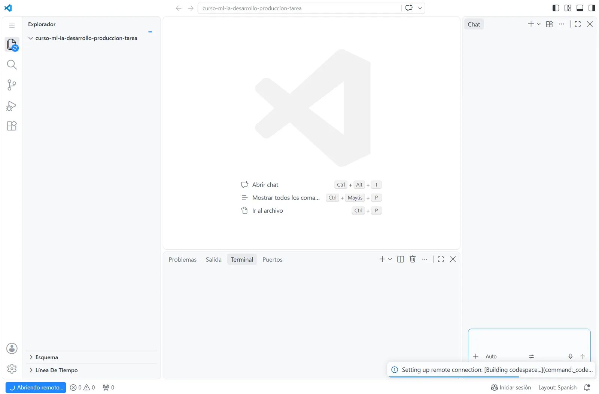

Cuando termine, la barra de estado de abajo a la izquierda muestra el nombre de tu Codespace (dos palabras al azar) y en la
terminal verás el resultado de la verificación del entorno, que se lanza sola al terminar la preparación.

**Si falla:** si aparece un aviso de que el Codespace está en **modo de recuperación** (el primer intento de la prueba real falló así),
ocurre lo siguiente:

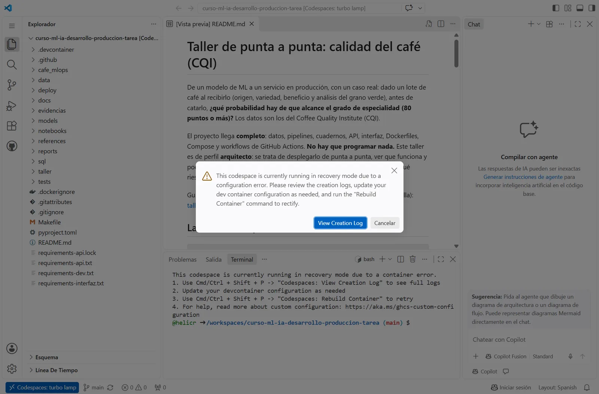

1. Pulsa **View Creation Log** (o `Ctrl+Mayús+P` > «Codespaces: View Creation Log») y mira la última línea con un error.
2. Pulsa `Ctrl+Mayús+P` > **«Codespaces: Rebuild Container»** y espera otros 4 a 5 minutos.
3. Si vuelve a fallar, borra ese Codespace (en `github.com/codespaces`) y crea otro.
4. Si sigue fallando, copia el registro y consúltalo con el instructor, con una captura.

La causa del fallo de la prueba (un repositorio de apt de yarn con la clave caducada que impedía instalar Docker) está **corregida** en
`.devcontainer/Dockerfile`; si te vuelve a pasar con otra causa, el registro la dirá.

**Evidencia (captura `02-codespace-abierto`):** la ventana del Codespace con el explorador de archivos, la terminal y, abajo a la
izquierda, el nombre del Codespace.

**Decisión de arquitectura:** el entorno de desarrollo es **código** (`.devcontainer/`): se reconstruye igual para cualquiera.
Cubre el riesgo de que el resultado dependa de lo que cada uno tenga instalado, y por eso Docker corre «dentro» del Codespace.

---

## Paso 4 · Primer arranque: avisos que verás

**Dónde:** Codespace.

**Qué debes ver y hacer:**

1. **«¿Confía en los autores de los archivos de esta carpeta?»**: pulsa **Confiar en la carpeta y continuar**. Sin esto la terminal
   no puede ejecutar nada (el aviso dice que «la creación de un proceso de terminal requiere la ejecución de código»).

   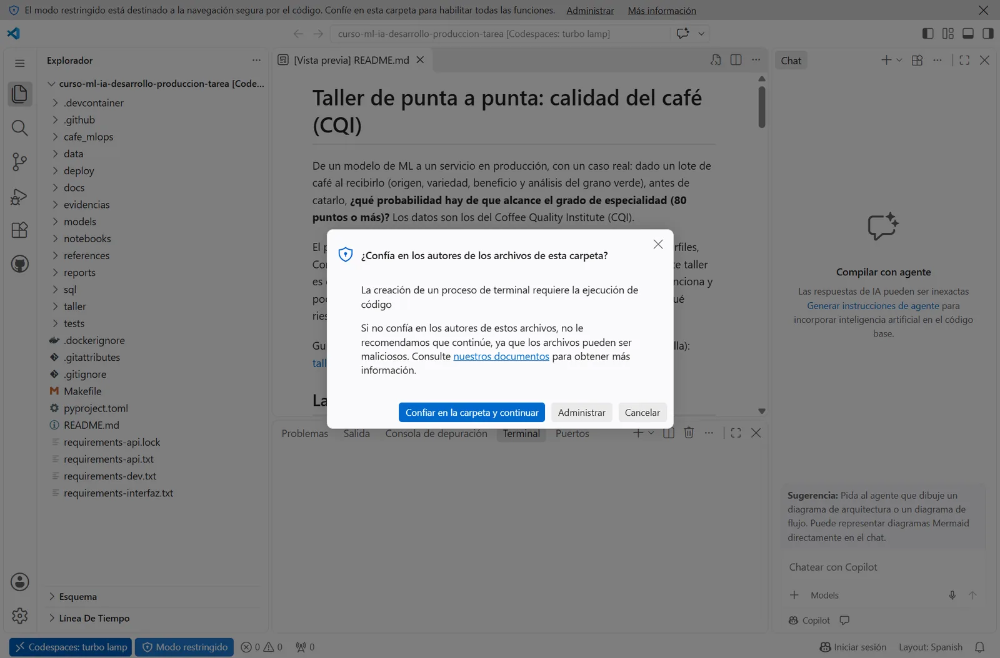

2. **«Sign in to GitHub to access your repositories and GitHub Actions workflows»**: es un aviso de la extensión de GitHub Actions.
   Puedes **cerrarlo** con la X; no hace falta para este taller.

   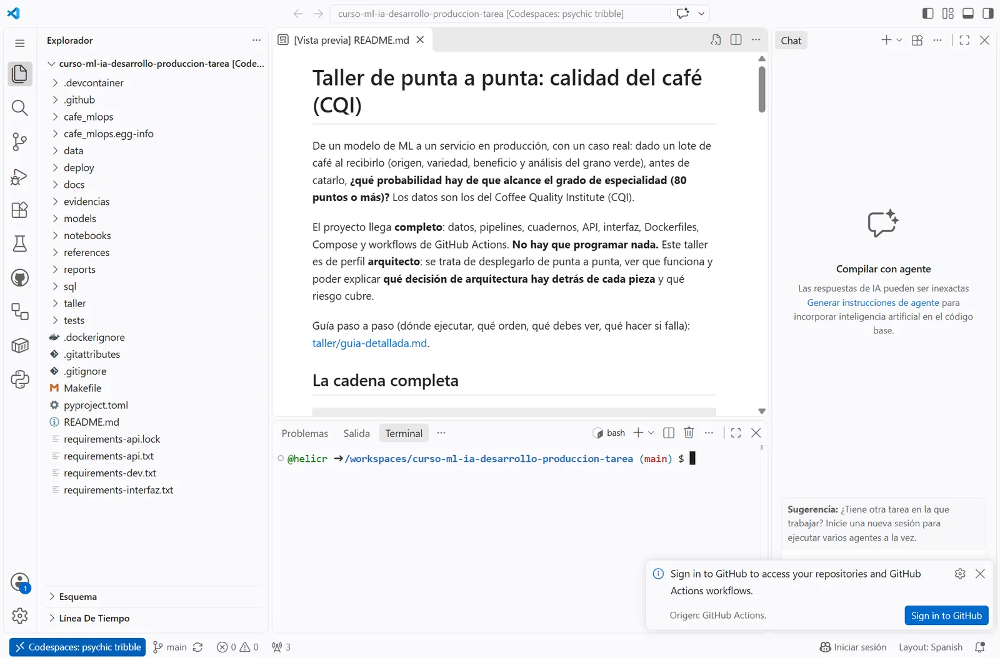

3. En el panel de abajo hay otras pestañas: **Terminal** (donde pegas los comandos), **Puertos** (lo usarás en el paso 13).
4. Si se abre un panel de chat a la derecha, puedes cerrarlo: no se usa.

**Si falla:** si la terminal no responde o sale «Modo restringido» en la barra de estado, vuelve a pulsar **Administrar** > **Confiar**
(arriba, en la franja gris) o recarga la ventana del navegador.

**Decisión de arquitectura:** abrir una carpeta en el Codespace puede ejecutar código del repositorio; la confianza es una decisión
explícita. Cubre el riesgo de la cadena de suministro: ejecutar código ajeno sin saberlo.

---

## Paso 5 · Verificar el entorno

**Dónde:** Codespace, pestaña **Terminal**.

**Comando:**

```bash
make verificar
```

**Qué debes ver** (medido en un Codespace real; en tu terminal es igual, con tu versión exacta de Python):

```text
[OK   ] python     Python 3.11.13
[OK   ] paquetes   11 paquetes con la versión exacta de requirements-dev.txt
[OK   ] cafe_mlops cafe_mlops se importa (API incluida)
[OK   ] datos      2 CSV con la huella SHA-256 de SHA256SUMS
[OK   ] docker     cliente 29.9.3 / servidor 29.9.3 · compose 2.40.3
LISTO PARA EL TALLER
```

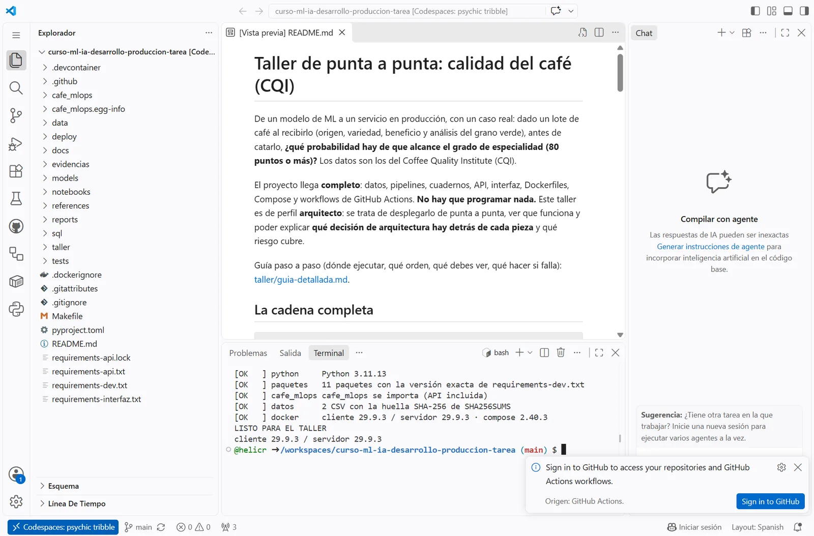

Comprueba **cinco** marcas `[OK   ]` y la última línea «LISTO PARA EL TALLER». Esta orden no instala ni cambia nada: solo lee.

**Si falla:** cada comprobación que no pasa sale como `[FALLA]` y la última línea dice qué falta. Por ejemplo, si el servidor de Docker
no estuviera disponible, verías (salida real de la ejecución en Windows, donde no hay Docker):

```salida-real
[FALLA] docker     docker no está instalado o no está en el PATH (en el Codespace lo trae el devcontainer)
FALTA: docker. Arregla lo marcado como FALLA y vuelve a ejecutar: python -m cafe_mlops.verificar
```

En el Codespace, un `[FALLA] docker` significa casi siempre que el Codespace no se construyó bien: vuelve al paso 3 («Si falla»).
Un `[FALLA] datos` con «no coincide con su huella» indica que algún CSV cambió (no los edites).

**Evidencia (captura `03-verificar-entorno`):** la terminal con las cinco marcas `[OK   ]` y «LISTO PARA EL TALLER».

**Decisión de arquitectura:** una **precondición comprobable**: versiones exactas de los paquetes, huella SHA-256 de los datos y
Docker vivo, antes de gastar minutos entrenando. Cubre el riesgo de obtener resultados no comparables por un entorno distinto o por
datos alterados.

---

## Paso 6 · Revisar el proyecto

**Dónde:** Codespace, explorador de archivos (izquierda) y el archivo `README.md`.

**Qué haces:** abre `README.md` y lee la tabla «Mapa del proyecto». Despliega las carpetas del explorador y reconoce cada una:
`data/raw/cqi` (los CSV), `sql/` (una carpeta por capa), `cafe_mlops/` (pipelines, `modeling/`, `api/`, `interfaz/`), `notebooks/`,
`deploy/docker/` (los Dockerfiles y `compose.yaml`), `.github/workflows/` (los dos workflows), `models/` y `reports/` (se llenan al
ejecutar). Opcional, para ver todas las órdenes disponibles:

```bash
make ayuda
```

**Qué debes ver:** la lista de órdenes del `Makefile` con su descripción (el texto exacto de esta orden en el Codespace no se ha
capturado: sin verificar).

**Si falla:** si `make` no se encuentra, no estás en la terminal del Codespace (en tu Windows no hay `make`).

**Decisión de arquitectura:** el proyecto separa **datos, lógica, servicio y despliegue** en carpetas distintas. Cubre el riesgo de que
un cambio en una parte rompa las demás sin que nadie lo vea.

---

## Paso 7 · Ejecutar los pipelines y obtener el modelo

**Dónde:** Codespace, Terminal, desde la raíz del repositorio (ya estás en ella).

**Comando:**

```bash
time make pipeline
```

Es la ejecución de punta a punta de los cuatro pipelines: **base operacional** (simula el laboratorio), **ingesta RAW**, **ingesta MASTER**
(con las reglas de calidad), **FS y ML** (variables y conjunto de modelado) y **entrenamiento**. La palabra `time` solo añade el tiempo al final.

**Qué debes ver:** unos 49 segundos de salida (medido en un Codespace real) con estas líneas entre otras (salida real, ejecutada en Windows;
las `...` indican líneas que no se copian aquí):

```salida-real
[operacional] creando cqi.db con catas hasta 2016 (todavía no existe); es la simulación del laboratorio, no un pipeline
  OPERACIONAL: catas hasta 2016 (versión 1 de los datos)
  OPERACIONAL: lotes              1,190 filas
...
[pipeline_ingesta_raw] ejecutando (huella de entrada 7379031448d0)
...
[pipeline_ingesta_master] ejecutando (huella de entrada 383d741d7a61)
  MASTER: master_lotes          1,190 filas
  MASTER: master_descartes          0 filas
  MASTER: calidad: 17 reglas, 3 alertas (R06, R07, R10)
[pipeline_ml] ejecutando (huella de entrada 0bca8b260914)
  FS: fs_lote 1,190 lotes, 10 variables (catálogo: 10)
  ML: train    866 lotes (2010-2014) | especialidad 714 (82.4 %) | no 152
  ML: valid    197 lotes (2015-2015) | especialidad 185 (93.9 %) | no 12
  ML: test     127 lotes (2016-2016) | especialidad 122 (96.1 %) | no 5
[pipeline_train] ejecutando (huella de entrada d07e66a45b41)
  Datos: huella c83699881a8880b9, catas hasta 2016 (versión 1 de los datos). Comprobación temporal OK: train 2010-2014 < valid 2015-2015 < test 2016-2016
...
  Mejor modelo: gradient_boosting. Guardado en models/modelo.joblib
  Registrado en MLflow como «cafe-especialidad», versión 1. Para verlo: python -m cafe_mlops.mlflow_ui
Resumen: ingesta_raw: ejecutado · ingesta_master: ejecutado · ml: ejecutado · train: ejecutado
```

Las últimas líneas, en el Codespace real, fueron:

```text
Resumen: ingesta_raw: ejecutado · ingesta_master: ejecutado · ml: ejecutado · train: ejecutado

real    0m49.003s
```

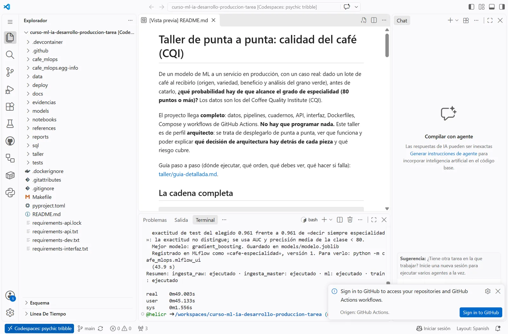

Lo que tienes que reconocer: «huella c83699881a8880b9» (la huella de los datos de la **versión 1**), «gradient_boosting» como mejor
modelo y «versión 1» en MLflow. Tus tiempos de cada línea de entrenamiento pueden variar.

**Si falla:**

- Si lo ejecutas en una terminal que no es la del Codespace (por ejemplo, en tu Windows), no hay `make`: no es la ruta de la tarea.
- Si una línea termina con un error de Python (una traza), copia las últimas 20 líneas y consúltalo: no edites nada. Un `make verificar` en
  verde descarta casi siempre un problema de entorno.
- No pegues `make pipeline HASTA=2018` en este paso: eso es el paso 16 y cambia la versión de los datos.

**Evidencia (captura `04-pipeline`):** la terminal con el final del pipeline: «Mejor modelo», «Registrado en MLflow ... versión 1», la línea
«Resumen» y el tiempo `real`.

**Decisión de arquitectura:** el dato pasa por **capas** (operacional, RAW, MASTER, FS, ML) y cada una es un paso que se puede ejecutar, probar y
auditar por separado; el modelo se entrena **solo** con variables que existen al recibir el lote (las notas de cata nunca entran). Cubre el riesgo de
reglas de datos escondidas en un cuaderno y de un modelo que «hace trampa» (fuga de información).

---

## Paso 8 · Repetir el pipeline: «sin cambios»

**Dónde:** Codespace, Terminal.

**Comando:**

```bash
make pipeline
```

**Qué debes ver** (salida real, ejecutada en Windows; en un Codespace tarda unos segundos, no el minuto del paso 7):

```salida-real
[pipeline_ingesta_raw] sin cambios: la entrada es la misma que en la ultima ejecucion (7379031448d0). Usa --forzar para rehacerlo.
[pipeline_ingesta_master] sin cambios: la entrada es la misma que en la ultima ejecucion (383d741d7a61). Usa --forzar para rehacerlo.
[pipeline_ml] sin cambios: la entrada es la misma que en la ultima ejecucion (0bca8b260914). Usa --forzar para rehacerlo.
[pipeline_train] sin cambios: la entrada es la misma que en la ultima ejecucion (d07e66a45b41). Usa --forzar para rehacerlo.
Resumen: ingesta_raw: sin cambios · ingesta_master: sin cambios · ml: sin cambios · train: sin cambios
```

Esta segunda ejecución dentro del Codespace no se ha cronometrado ni capturado (sin verificar allí).

**Si falla:** si ves «ejecutado» en lugar de «sin cambios», es que algo cambió en los datos de entrada (por ejemplo, ejecutaste el paso 16
entre medias). No es un fallo: vuelve a ejecutar `make pipeline` una vez más.

**Evidencia (captura `05-pipeline-sin-cambios`):** la terminal con las cuatro líneas «sin cambios» y la línea «Resumen».

**Decisión de arquitectura:** cada pipeline calcula una **huella de su entrada** y si no cambió, no hace nada (**idempotencia**). Cubre el riesgo de
ejecuciones repetidas que cuestan tiempo, producen resultados distintos o dejan datos a medias.

---

## Paso 9 · Comprobar el modelo y su versión

**Dónde:** Codespace, Terminal.

**Comando:**

```bash
make comparar
```

**Qué debes ver:** una tabla con **cuatro caminos** de predicción (el paquete, el archivo `joblib`, MLflow con sklearn y MLflow `pyfunc`) y que
todos dan la misma probabilidad. Salida real (ejecutada en Windows):

```salida-real
100 filas reales de la partición test · tolerancia 1e-09
camino                                    filas     diferencia máxima  resultado
paquete (referencia)                        100             0.000e+00  coincide
joblib                                      100             0.000e+00  coincide
MLflow sklearn                              100             0.000e+00  coincide
MLflow pyfunc                               100             0.000e+00  coincide
Todos los caminos dan la misma probabilidad.
```

Después hay una línea que empieza por «Ventana común» y otra por «Referencia», que comparan este modelo con `models/referencia.json` (la última
versión aprobada). Con la versión 1 (los datos de este paso) no hay diferencia con la referencia (así se comprobó en las pruebas automáticas);
el texto exacto de esas dos líneas dentro del Codespace no se ha capturado (sin verificar). En el paso 16 volverás a verlas con la versión 2.

**La versión que queda disponible** es la que dijo el pipeline: «Registrado en MLflow como «cafe-especialidad», versión 1», con la huella de datos
`c83699881a8880b9`. La verás también en la cabecera de la interfaz (paso 13).

**Opcional:** `make mlflow` abre la interfaz de MLflow en el puerto 5000 (`Ctrl+C` para cerrarla; en la pestaña Puertos se abre como en el paso 13).
**No se ha probado en el Codespace** (sin verificar). No hace falta para la tarea.

**Si falla:** si `make comparar` dice que falta el modelo o los metadatos, no has ejecutado el paso 7 (o has borrado `models/`).
Si alguna fila dice distinto de «coincide», **no sigas**: es justo el problema que esta comprobación existe para detectar. Consulta.

**Evidencia (captura `06-modelo-version`):** la terminal con la tabla de los cuatro caminos y «Todos los caminos dan la misma probabilidad.»,
y, si cabe, la línea «versión 1» del paso 7.

**Decisión de arquitectura:** un **registro de modelos** (MLflow) y una comprobación de que entrenamiento y servicio dan lo mismo. Cubre el riesgo
de la *deriva* entre el modelo que probaste y el que sirves (otra versión de una librería, otro orden de columnas, un nulo mal tratado).

---

## Paso 10 · Servir el modelo como procesos (opcional, recomendado)

**Dónde:** Codespace, **dos** terminales (pulsa **+** en el panel Terminal para abrir la segunda).

Es el primer escalón de despliegue: la API y la interfaz como dos procesos. Solo se probó en Windows, no en el Codespace (sin verificar allí).
Si vas justo de tiempo, sáltalo: el paso 11 lo reemplaza por contenedores.

**Comando (terminal 1):**

```bash
make api
```

**Comando (terminal 2):** primero comprueba la API, después abre la interfaz:

```bash
curl -s http://127.0.0.1:8080/salud
curl -s http://127.0.0.1:8080/listo
```

**Qué debes ver** (salida real, ejecutada en Windows):

```salida-real-json
{
 "estado": "ok"
}
```

```salida-real-json
{
 "estado": "listo"
}
```

Una predicción con el lote de ejemplo del repositorio:

```bash
curl -s -X POST http://127.0.0.1:8080/predecir -H 'Content-Type: application/json' -d @tests/datos/lote_ejemplo.json
```

Salida real de la ejecución en Windows. **Ojo con la versión:** esas salidas se capturaron **después** de `--hasta 2018`, así que dicen
versión 2 y huella `bebc87b9eddf0199`. En tu Codespace, con los datos de este paso, verás `"version_modelo": "1"` y
`"huella_datos": "c83699881a8880b9"`. La probabilidad exacta con la versión 1 no se ha medido (sin verificar); no tiene que ser igual:

```salida-real-json
{
 "probabilidad_especialidad": 0.9812706265623319,
 "modelo": "gradient_boosting",
 "version_modelo": "2",
 "huella_datos": "bebc87b9eddf0199",
 "avisos": []
}
```

Un lote imposible (`tests/datos/lote_imposible.json`) da un **422** con la lista de campos erróneos, y un lote con un país nunca visto
(`tests/datos/lote_categoria_nueva.json`) da **200 con un aviso**; el contrato completo está en [docs/api-y-contenedor.md](../docs/api-y-contenedor.md).
La documentación interactiva de la API está en `/docs` (pestaña Puertos, puerto 8080).

Para parar, `Ctrl+C` en la terminal 1. **Antes del paso 12 no dejes nada escuchando en el 8090**: si también abres `make interfaz` aquí, páralo.

**Si falla:** si `make api` dice que no hay modelo, ejecuta antes el paso 7. Si el puerto 8080 está ocupado, hay otro proceso tuyo corriendo: ciérralo.

**Decisión de arquitectura:** la **API es el contrato** entre quien entrena el modelo y quien lo usa: valida la entrada (422), avisa de lo que el modelo
no conoce (200 con avisos) y nunca devuelve trazas. Cubre el riesgo de predecir con datos mal formados y de filtrar información interna.

---

## Paso 11 · Construir las dos imágenes

**Dónde:** Codespace, Terminal (en una sola terminal, sin procesos ocupando puertos).

**Comando:**

```bash
time make imagenes
```

Construye `cafe-api:local` (la API con el modelo dentro) y `cafe-interfaz:local`. Después, para ver las imágenes y su tamaño:

```bash
docker image ls 'cafe-*'
```

**Atención:** la orden lleva **un solo argumento entre comillas**. Con Docker 29, `docker image ls cafe-api cafe-interfaz` (con dos argumentos) **da un error**.

**Qué debes ver:** unos 1 min 18 s con la caché de capas vacía (medido en un Codespace real). Las últimas líneas de la construcción son del estilo
«#10 DONE 1.1s» y el cierre del tiempo:

```text
#10 DONE 1.1s

real    1m18.367s
```

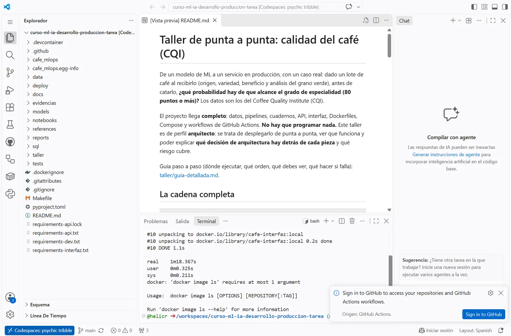

Y `docker image ls 'cafe-*'` debe mostrar **dos** imágenes, `cafe-api` y `cafe-interfaz`, con etiqueta `local`. Los tamaños medidos en GitHub Actions
(en tu Codespace no se capturaron: sin verificar) son estos:

| Imagen | Tamaño | Comprimida | Qué lleva |
|---|---|---|---|
| `cafe-api` | 826 MB | 183 MB | El paquete, el modelo y las dependencias exactas (scikit-learn, MLflow...). |
| `cafe-interfaz` | 213 MB | 51 MB | Solo el código y fastapi, uvicorn y pydantic: **sin** scikit-learn ni modelo. |

**Si falla:**

- Si ves `docker: 'docker image ls' requires at most 1 argument`, es el error de los dos argumentos (aparece al final de la captura). Usa el comando con comillas.
- Si `make imagenes` dice que no encuentra `models/modelo_mlflow`, no ejecutaste el paso 7.
- Si `docker` no responde, repite `make verificar` (paso 5): debe decir `[OK   ] docker`.

**Evidencia (captura `07-imagenes`):** la terminal con el final de `make imagenes` (tiempo incluido) y la salida de `docker image ls 'cafe-*'` con las dos imágenes.

**Decisión de arquitectura:** una **imagen** empaqueta el entorno junto con la aplicación (versiones exactas, usuario sin privilegios, base mínima). Se
construyen **dos** y no una porque el modelo cambia con cada reentrenamiento y la interfaz no: la de la interfaz es 4 veces más pequeña y no lleva
scikit-learn, con menos superficie de ataque. Cubre el riesgo de entornos distintos entre desarrollo y producción.

---

## Paso 12 · Levantar los contenedores con Compose

**Dónde:** Codespace, Terminal.

**Comando:**

```bash
time make compose-arriba
```

y, a continuación:

```bash
docker compose -f deploy/docker/compose.yaml ps
```

**Qué debes ver:** unos 13 s (medido en un Codespace real) y, antes del tiempo, los dos contenedores sanos:

```text
 Container cafe-api-1  Healthy
 Container cafe-interfaz-1  Healthy

real    0m13.116s
```

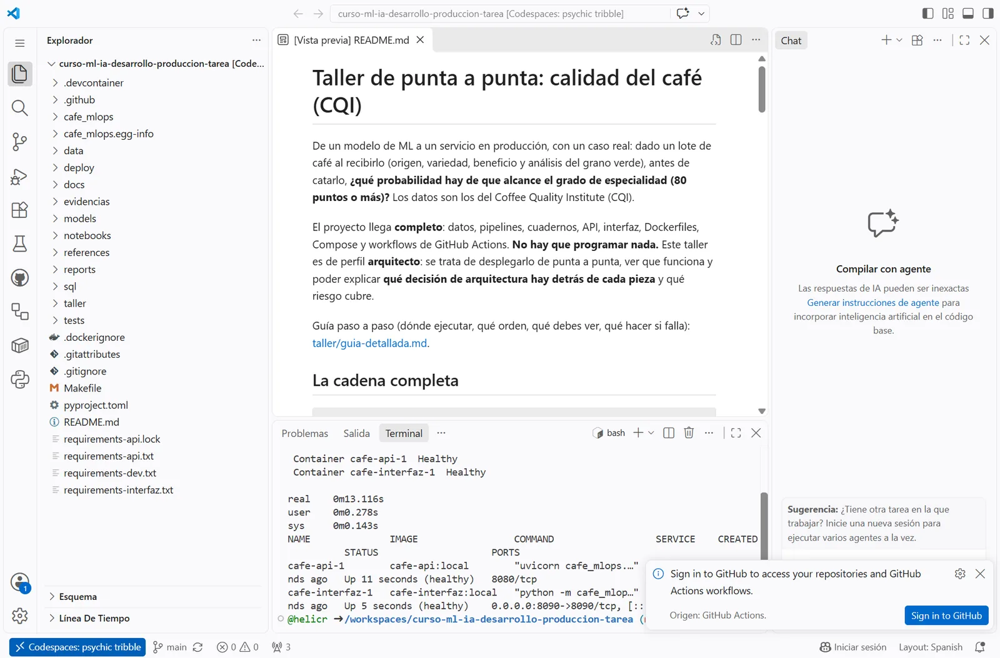

En la tabla de `docker compose ps`: `cafe-api-1` con `Up ... (healthy)` y `8080/tcp` (**sin** flecha: la API no se publica fuera), y
`cafe-interfaz-1` con `Up ... (healthy)` y `0.0.0.0:8090->8090/tcp`.

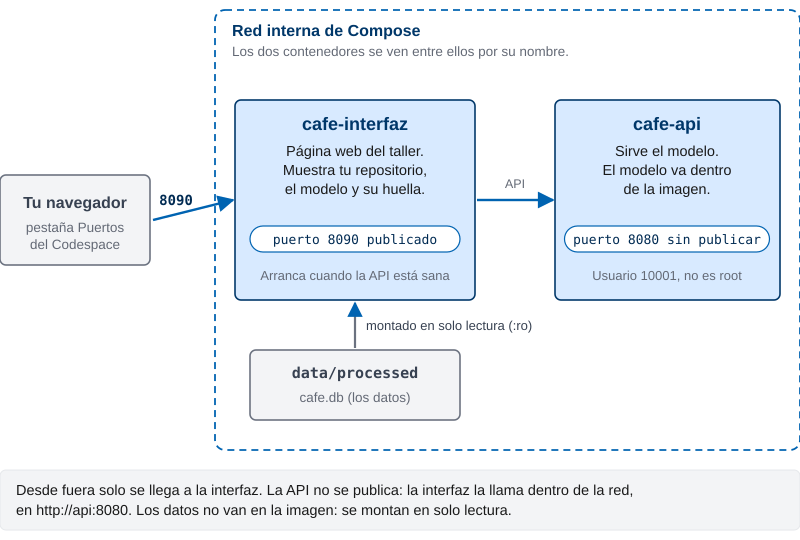

**Si falla:**

- Si algo escucha ya en el puerto 8090 (por ejemplo, el `make interfaz` del paso 10), ciérralo con `Ctrl+C`. El texto exacto del error no se ha capturado (sin verificar).
- Si la espera termina con un contenedor no sano, mira su registro: `docker compose -f deploy/docker/compose.yaml logs api` (o `interfaz`).
- Si no ejecutaste el paso 7, la imagen de la API no lleva modelo y no llegará a estar sana.
- Para empezar de cero: `make compose-abajo` y de nuevo `make compose-arriba`.

**Evidencia (captura `08-compose-sano`):** la terminal con «Container cafe-api-1 Healthy», «Container cafe-interfaz-1 Healthy» y la tabla de `docker compose ps`.

**Decisión de arquitectura:** **Compose** describe la topología entera en un archivo. Decide tres cosas: la API **no se publica** (solo la interfaz, dentro de la red, la
llama: menos superficie expuesta); los datos se **montan en solo lectura** (la interfaz no puede escribir en la base aunque tuviera un fallo); y la interfaz **espera** a que la API esté
sana. Cubre el riesgo de arrancar un servicio que depende de otro que aún no responde y el de exponer más de lo necesario.

---

## Paso 13 · Abrir la interfaz por el puerto 8090

**Dónde:** Codespace, pestaña **Puertos** (al lado de Terminal), y después una pestaña nueva del navegador.

**Qué haces:**

1. Abre la pestaña **Puertos**. Ahí debe aparecer el **8090** con la etiqueta «Interfaz (UI)» (el devcontainer declara también el 8080 y el 5000, pero con Compose solo escucha el 8090).
2. En la fila del 8090, pulsa el icono del **globo** («Abrir en el navegador») o haz clic derecho > **Open in Browser**. Si salta una notificación «Your application running on port 8090 is available», también sirve su botón.
3. Se abre una dirección parecida a `https://<nombre-del-codespace>-8090.app.github.dev`.

**Qué debes ver:** la página «¿Será café de especialidad?» y, arriba, la cabecera con tu repositorio, el modelo y su versión, el estado de la API y los lotes de la base:

```text
Repositorio: <tu-usuario>/taller-ml-ia-dev-production   Modelo: gradient_boosting v1 · huella c83699881a8880b9   API: lista   Lotes en la base: 1190
```

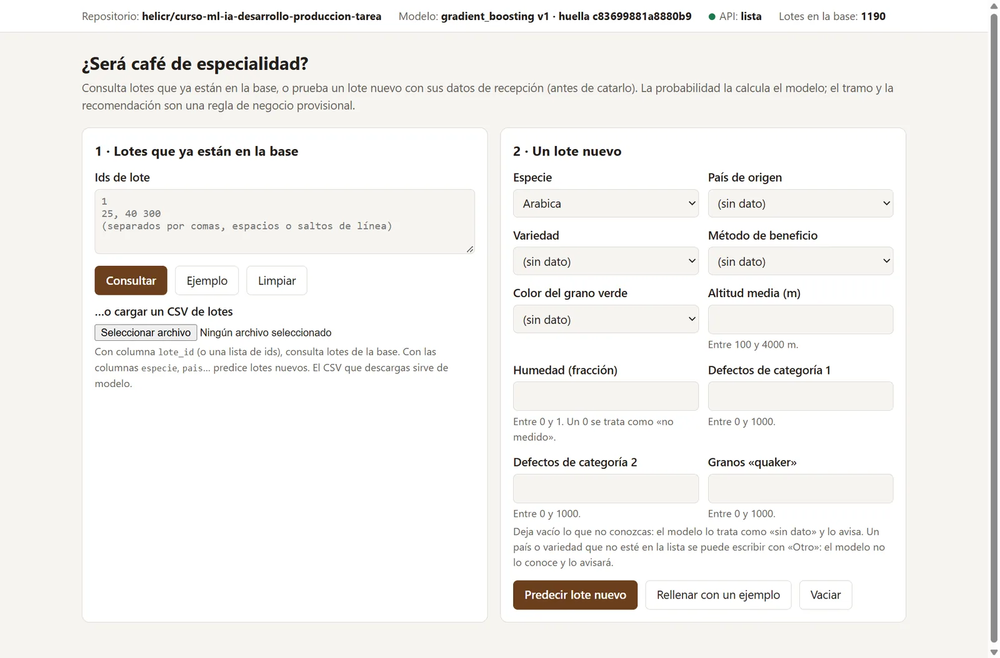

**Si falla:**

- **Los puertos reenviados son privados por defecto**: solo se abren con tu sesión de GitHub. Abre la interfaz en el **mismo navegador** donde tienes la sesión iniciada. Si pide iniciar sesión, hazlo con la cuenta propietaria del Codespace. El texto exacto del error de un puerto privado sin sesión no se ha capturado (sin verificar).
- Si la cabecera no dice «API: lista», vuelve al paso 12 y revisa que los dos contenedores estén sanos (los demás textos de error de la cabecera no se han capturado: sin verificar).
- Si no aparece el puerto 8090 en la lista, ejecuta `make compose-arriba` otra vez.
- No hace falta cambiar la visibilidad del puerto a pública para esta tarea. Si lo haces, tu interfaz queda abierta a cualquiera con el enlace: vuelve a ponerla privada al terminar.

**Evidencia (captura `09-puerto-8090`):** la pestaña **Puertos** con el 8090 (etiqueta y dirección). **Captura `10-ui-cabecera`:** el navegador con la interfaz y la cabecera completa (se ve tu repositorio).

**Decisión de arquitectura:** **un único punto de entrada** (la interfaz en el 8090); el resto del sistema queda dentro de la red de contenedores. Cubre el riesgo de exponer una API sin autenticación. En este taller no hay
TLS ni login propios: es una de las cosas que faltan para una producción real (ver [docs/del-ordenador-al-servicio.md](../docs/del-ordenador-al-servicio.md)).

---

## Paso 14 · Consumir el modelo desde la interfaz

**Dónde:** navegador, en la interfaz del puerto 8090.

**Qué haces:**

1. En «1 · Lotes que ya están en la base» pulsa **Ejemplo** (rellena una lista de ids de lote y añade el 99999, que no existe) y después **Consultar**.
2. Lee el **Resultado**: los lotes por tramos (alta, media, baja), cada probabilidad con su recomendación, y los **avisos** del modelo (en amarillo).
3. En «2 · Un lote nuevo» pulsa **Rellenar con un ejemplo** y después **Predecir lote nuevo**. Cambia el país o la variedad a **Otro** y escribe un valor inventado para ver el aviso de «categoría que el modelo no conoce».
4. Pulsa un «Ver» de la columna Variables para ver las variables que usó el modelo.

**Qué debes ver** (medido en un Codespace real con la versión 1): «5 de 6 lotes con predicción» (4 en el tramo alta y 1 en el tramo baja) y, como no predicho, el lote 99999:

```text
Tramo alta (≥ 90 %): 4    Tramo media (80 % – 90 %): 0    Tramo baja (< 80 %): 1
5 de 6 lotes con predicción.
Sin predicción (1):  99999: no existe en la capa FS (solo hay lotes con cata válida)
Modelo gradient_boosting v1 · huella c83699881a8880b9.
```

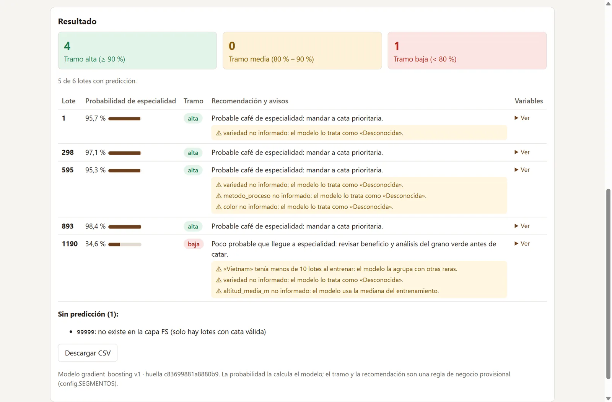

Verás también avisos como «variedad no informado: el modelo lo trata como «Desconocida»» y, en el lote 1190, un aviso de que «Vietnam» tenía menos de 10 lotes al entrenar. Que haya avisos es **correcto**: la interfaz no esconde la incertidumbre.

Las pruebas automáticas cubren «Predecir lote nuevo» (formulario, CSV, avisos); a mano, dentro del Codespace, solo se probó la consulta de lotes por id (sin verificar el formulario de lote nuevo en el Codespace).

**Si falla:**

- Si «Consultar» muestra un mensaje de error, léelo: la interfaz responde en español y sin trazas, y dice si falta la base o si la API no responde.
- Si todos los lotes salen «sin predicción», lo más probable es que la base de datos no existiera al levantar Compose (causa probable, sin verificar): ejecuta el paso 7 y repite el paso 12.
- Los umbrales de los tramos (90 % y 80 %) son una regla de negocio **provisional**: no los cambies ni los trates como un resultado del modelo.

**Evidencia (captura `11-ui-resultado`):** la interfaz con el Resultado de una consulta (tramos, probabilidades, avisos y el pie con «Modelo gradient_boosting v1 · huella ...»).

**Decisión de arquitectura:** la interfaz **traduce una probabilidad en una decisión de negocio** (tramos y recomendación) y, a la vez, muestra la **huella del modelo** que respondió (trazabilidad) y los
**avisos** (el modelo no oculta su incertidumbre). Cubre el riesgo de que alguien tome una decisión con una cifra sin saber de qué modelo viene ni con cuánto respaldo.

---

## Paso 15 · Grabar el vídeo y parar los contenedores

**Dónde:** navegador (interfaz) y Codespace (terminal), con tu grabador de pantalla.

**Qué haces:** con los contenedores levantados (paso 12) y la interfaz abierta (paso 14), graba **de 2 a 4 minutos con tu voz** el servicio funcionando **a través de la interfaz** y explica la arquitectura.
El método (sin herramientas especiales), qué debe verse y cómo bajarlo de 50 MB está en [guia-grabacion-video.md](guia-grabacion-video.md). Guarda el archivo como `evidencias/video/servicio-en-produccion.mp4`.

Cuando termines de grabar, para el servicio:

```bash
make compose-abajo
```

**Qué debes ver:** los contenedores y la red se detienen y se borran; las imágenes y los datos quedan (puedes volver a levantar con `make compose-arriba`).

**Si falla:** si tras parar necesitas repetir una toma, vuelve a levantar con `make compose-arriba` (13 s con las imágenes ya construidas).

**Evidencia:** el vídeo, `evidencias/video/servicio-en-produccion.mp4` (no es una captura: va en la carpeta `video/`).

**Decisión de arquitectura:** el vídeo es la **prueba de operación**: el servicio, por su interfaz y con el modelo en producción, funciona. Cubre el riesgo de entregar «una receta» sin demostrar que sirve.

---

## Paso 16 · Llegan lotes nuevos: la versión 2 (opcional, recomendado)

**Dónde:** Codespace, Terminal.

**Qué haces:** simulas que el laboratorio manda catas hasta 2018 y ves cómo se comporta la **puerta de calidad**. Es lo que luego hará GitHub Actions; hacerlo aquí te permite entenderlo.

**Comandos:**

```bash
make pipeline HASTA=2018
make comparar
```

**Qué debes ver** (salida real, ejecutada en Windows; dentro del Codespace no se ha probado, sin verificar). El pipeline rehace todo y crea la **versión 2** del modelo:

```salida-real
[operacional] creando cqi.db con catas hasta 2018 (tenía catas hasta 2016); es la simulación del laboratorio, no un pipeline
  OPERACIONAL: catas hasta 2018 (versión 2 de los datos)
  OPERACIONAL: lotes              1,339 filas
  MASTER: master_lotes          1,338 filas
  MASTER: master_descartes          1 filas
  Datos: huella bebc87b9eddf0199, catas hasta 2018 (versión 2 de los datos). Comprobación temporal OK: train 2010-2015 < valid 2016-2016 < test 2017-2018
  Registrado en MLflow como «cafe-especialidad», versión 2. Para verlo: python -m cafe_mlops.mlflow_ui
Resumen: ingesta_raw: ejecutado · ingesta_master: ejecutado · ml: ejecutado · train: ejecutado
```

Y `make comparar`, con la tolerancia por defecto (0,02), **rechaza** la versión 2: devuelve un código de salida distinto de 0 y la última línea dice:

```salida-real
Referencia: auc_comun candidata 0.7951 frente a referencia 0.8525 (diferencia -0.0574, tolerancia 0.02; mismos datos: no) -> RECHAZADA: empeora más que la tolerancia
```

Con una tolerancia de 0,10 la misma versión se **aprueba**:

```bash
python -m cafe_mlops.modeling.comparar --tolerancia-referencia 0.10
```

```salida-real
Referencia: auc_comun candidata 0.7951 frente a referencia 0.8525 (diferencia -0.0574, tolerancia 0.1; mismos datos: no) -> APROBADA
```

**Para explicar con tus palabras** (es la pregunta clave de comprensión): la versión 2 «empeora» 0,0574 en una ventana común (el año 2016) que solo tiene **5 lotes sin especialidad**; con tan pocos casos
negativos, el AUC oscila más que 0,02 por puro azar (el intervalo del 95 % va de 0,49 a 1,00 en la versión 2). **Subir la tolerancia es una decisión de arquitecto que debes justificar; no sale de una medición.**

**Si falla:** el código de salida distinto de 0 de la primera `comparar` **no es un fallo**: es el rechazo. Si ahora quieres volver al estado inicial para repetir pasos, ejecuta `make pipeline HASTA=2016`.

**Decisión de arquitectura:** una **puerta de calidad automática**: un modelo nuevo no se publica si empeora frente a la última versión aprobada. Cubre el riesgo de desplegar un modelo peor, y al mismo tiempo el de bloquear una mejora real por ruido de medida.

---

## Paso 17 · Habilitar GitHub Actions en tu fork

**Dónde:** navegador, en tu fork: pestaña **Actions**.

**Qué haces:** los workflows de un fork **vienen desactivados**. En la pestaña **Actions** pulsa el botón verde **«I understand my workflows, go ahead and enable them»** (el texto exacto puede cambiar).

**Qué debes ver:** a la izquierda, dos workflows: **Validar** y **Nueva version del modelo** (sin tilde en «version», tal como está escrito en el archivo).

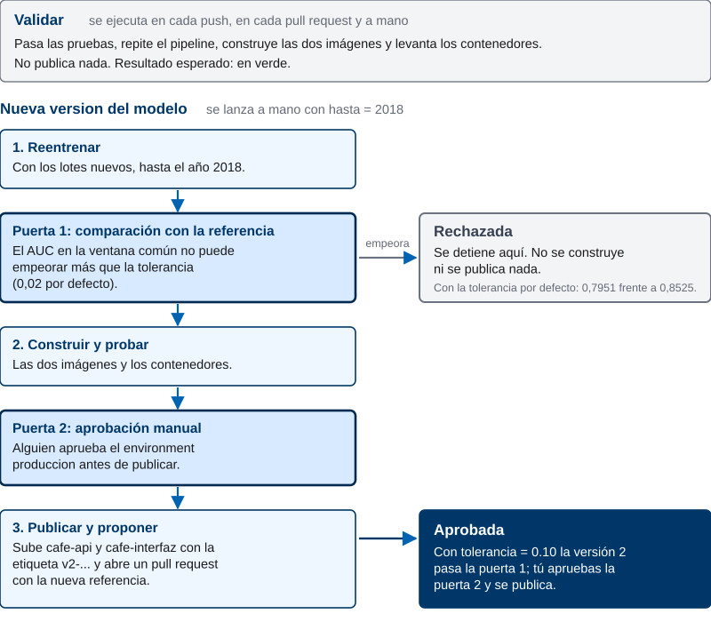

**Si falla:** si la pestaña Actions no existe, comprueba en Settings > Actions > General que las Actions estén permitidas. Los workflows de tu fork publicarán en **tu** espacio de GHCR (`ghcr.io/<tu-usuario>/...`), no en el del instructor.
Cómo se ve esta pantalla en una cuenta distinta del instructor está sin verificar.

**Decisión de arquitectura:** GitHub no ejecuta automáticamente código de terceros en un fork: el dueño decide **activarlo**. Cubre el riesgo de ejecutar, con tus permisos, flujos que no revisaste.

---

## Paso 18 · Lanzar `Validar`

**Dónde:** navegador, pestaña **Actions** de tu fork.

**Qué haces:** elige el workflow **Validar** a la izquierda > **Run workflow** > rama `main` > **Run workflow**. (También se ejecuta solo con cada `push`.)

**Qué debes ver:** unos 7 min 42 s después, la ejecución en **verde** (resultado medido en GitHub Actions en el repositorio de prueba). Dentro, entre otras cosas (cifras reales de esa ejecución):

| Qué comprueba | Resultado medido |
|---|---|
| Pruebas | 422 pasan |
| Pipeline repetido | «sin cambios» |
| Imágenes | `cafe-api` 826 MB (183 MB comprimida), `cafe-interfaz` 213 MB (51 MB comprimida); las dos con el usuario 10001; la interfaz sin scikit-learn |
| Compose | sano; la API **no** se publica fuera |
| Predicción por la interfaz | correcta |

Las cifras aparecen como anotaciones en el resumen de la ejecución.

**Si falla:** abre el paso en rojo y lee su registro; el workflow publica el motivo del fallo. Si falla por «permission» o no arranca nada, vuelve al paso 17 (¿habilitaste las Actions?). Un fallo en tu fork que no apareció en la prueba es un hallazgo: guarda su captura y consúltalo.

**Evidencia (captura `12-validar-verde`):** la ejecución de **Validar** terminada en verde (con el nombre del workflow, el repositorio y la duración).

**Decisión de arquitectura:** la **integración continua** repite todo el recorrido en un entorno limpio, sin tu equipo. Es la prueba de que «funciona en mi equipo» no depende de tu equipo. Cubre el riesgo de que algo solo funcione por lo que tú tenías instalado.

---

## Paso 19 · Preparar el environment `produccion` y los permisos

**Dónde:** navegador, **Settings** de tu fork. **Esto lo configuras tú**: viene sin hacer en tu fork.

**Qué haces:**

1. **Settings** > **Environments** > **New environment** > nombre exactamente `produccion` > **Configure environment**. Marca **Required reviewers** y añádete **a ti mismo** como revisor; guarda con **Save protection rules**.
   Si el environment existe sin revisores, la publicación **no esperaría a nadie**: sin revisor no hay aprobación manual y el paso 21 no se parecería a lo que se pide.
2. **Settings** > **Actions** > **General** > **Workflow permissions** > marca **«Allow GitHub Actions to create and approve pull requests»** y guarda. Sin esto, el último paso del workflow, el que abre el pull request con la nueva referencia, falla con un error de permisos.

**Qué debes ver:** en **Settings > Environments**, `produccion` con «Required reviewers» y tu usuario; y en **Actions > General**, la casilla marcada.

**Si falla:** en la prueba real hicieron falta exactamente estos dos ajustes. Si en tu cuenta el botón de revisores aparece deshabilitado, anótalo con una captura y consúltalo (sin verificar en una cuenta de alumno).

**Evidencia (captura `13-environment-produccion`):** la página del environment `produccion` con el revisor configurado.

**Decisión de arquitectura:** una **puerta humana** antes de producción, y **permisos mínimos**: el workflow no lleva secretos propios, usa el `GITHUB_TOKEN` y cada trabajo pide solo lo que necesita. Cubre el riesgo de que un cambio llegue a producción sin que una persona lo apruebe y el de un robo de credenciales.

---

## Paso 20 · `Nueva version del modelo` con la tolerancia por defecto: rechazada

**Dónde:** navegador, **Actions** > **Nueva version del modelo** > **Run workflow**.

**Qué haces:** pon `hasta` = `2018` (es el valor por defecto) y **deja `tolerancia` vacía**. Pulsa **Run workflow**.

**Qué debes ver:** unos 1 min 34 s después, la ejecución termina **en rojo, a propósito**: el trabajo «Reentrenar y comparar con la referencia» se para con el error «Version rechazada»
(«El modelo nuevo EMPEORA mas que la tolerancia (0.02) frente a la referencia ... No se construye ni se publica nada»). Cifras reales de esa ejecución:

| Dato | Valor |
|---|---|
| `hasta` | 2018 |
| Tolerancia | 0,02 |
| AUC en la ventana común, candidata | 0,7951 |
| AUC en la ventana común, referencia | 0,8525 |
| Diferencia | -0,0574 |
| Resultado | RECHAZADA; no se construye ni publica nada |

**Si falla:** si termina en verde, es que pusiste una tolerancia o un `hasta` distintos (con `hasta` = 2016 los datos son los de la referencia y el workflow termina sin hacer nada). Si falla **antes** del reentrenamiento, vuelve al paso 17.

**Evidencia (captura `14-nueva-version-rechazada`):** la ejecución con el error «Version rechazada» y su mensaje (se leen las cifras 0,7951, 0,8525 y -0,0574).

**Decisión de arquitectura:** la **puerta de calidad** detiene automáticamente un modelo peor antes de gastar recursos construyendo y publicando. Cubre el riesgo de desplegar una regresión.

---

## Paso 21 · `Nueva version del modelo` con tolerancia 0,10: aprobación manual y publicación

**Dónde:** navegador, **Actions** > **Nueva version del modelo** > **Run workflow**.

**Qué haces:** `hasta` = `2018` y **`tolerancia` = `0.10`**. Pulsa **Run workflow**. Cuando el trabajo «Publicar en GHCR (con aprobacion manual)» quede **en espera** (GitHub suele mostrar
«Waiting for review» y un botón **Review deployments**; esos textos exactos están sin verificar), pulsa **Review deployments**, marca `produccion` y pulsa **Approve and deploy**.

**Qué debes ver:** 4 min 30 s de ejecución, más lo que tardes en aprobar. Los trabajos, en orden: reentrenar y comparar (aprobada, huella `bebc87b9eddf0199`), construir y probar las dos imágenes, **esperar la aprobación del environment `produccion`**, publicar en GHCR y abrir un pull request. En el primer trabajo verás la línea:

```text
Referencia: auc_comun candidata 0.7951 frente a referencia 0.8525 (diferencia -0.0574, tolerancia 0.1; mismos datos: no) -> APROBADA
```

**Si falla:** si el trabajo de publicación **no se queda esperando**, el environment `produccion` no tiene revisores (vuelve al paso 19). Si el último trabajo falla con un error de permisos al abrir el pull request, falta la casilla «Allow GitHub Actions to create and approve pull requests» (paso 19).

**Evidencia (captura `15-nueva-version-aprobacion`):** la ejecución con la aprobación pendiente (o ya aprobada) del environment `produccion` y los trabajos en verde.

**Decisión de arquitectura:** el paso a producción exige una **decisión humana explícita**, y la **tolerancia de 0,10** es una decisión de arquitecto: se justifica con que la ventana común tiene 5 lotes sin especialidad y el AUC oscila, no con una medición. Cubre el riesgo de automatizar tanto que nadie decida.

---

## Paso 22 · Comprobar los paquetes publicados y el pull request

**Dónde:** navegador, en tu fork: la página principal (columna derecha, «Packages») y la pestaña **Pull requests**.

**Qué debes ver** (resultado medido en el repositorio de prueba; el usuario será el tuyo):

- Dos paquetes en GHCR: `ghcr.io/<tu-usuario>/cafe-api:v2-bebc87b9eddf0199` y `ghcr.io/<tu-usuario>/cafe-interfaz:v2-bebc87b9eddf0199` (la etiqueta es `v<versión de los datos>-<huella de los datos>`).
- Un **pull request** que actualiza `models/referencia.json` con la nueva referencia. **No** lo hace con un push a `main`: la referencia nueva entra cuando una persona fusiona ese pull request.

**Si falla:** los paquetes de GHCR **nacen privados**; si tu fork es público, quedan públicos (en la prueba real, tras la primera publicación figuraban como públicos y su manifiesto se descargó sin sesión con HTTP 200). Si los ves privados,
en Packages > el paquete > **Package settings** > **Change visibility** > Public. Descargarlos con `docker pull` desde un Codespace no se probó (sin verificar). Un pull request creado por el workflow no lanza `Validar` por sí solo (es una regla de GitHub): no es un fallo.

**Evidencia (captura `16-paquetes-y-pr`):** la página de paquetes o la lista de pull requests con los dos paquetes `v2-...` y el pull request abierto.

**Decisión de arquitectura:** el artefacto desplegable es una **imagen versionada con la huella de los datos** (`v2-<huella>`): se sabe con qué datos se entrenó lo que está en producción. La referencia vive en el repositorio y **cambia por pull request**,
como cualquier otro cambio: queda revisada y auditada. Cubre el riesgo de no saber qué hay desplegado ni de dónde salió.

---

## Paso 23 · Entregar

**Dónde:** Codespace (terminal) y navegador.

**Qué haces:**

1. Guarda las capturas en `evidencias/capturas/` con el nombre de la plantilla (`01-fork-renombrado.png`, etc.) y el vídeo en `evidencias/video/servicio-en-produccion.mp4` (arrástralos desde tu equipo al explorador del Codespace).
2. Rellena `evidencias/plantilla-evidencias.md` (con tu explicación de arquitectura por captura).
3. Sube todo a tu fork:

   ```bash
   git add evidencias
   git commit -m "Evidencias de la tarea"
   git push
   ```

   El vídeo puede pesar hasta 50 MB: **por la terminal se sube bien**. Por el botón «Upload files» de la web de GitHub, el límite documentado es de 25 MB por archivo (sin verificar aquí): si tu vídeo es más grande, usa la terminal.
   Cada `push` lanza el workflow `Validar` (unos 8 minutos): es normal.
4. Comprueba en el navegador que tu fork se llama `taller-ml-ia-dev-production`, es **público** y que `evidencias/` contiene las capturas y el vídeo.
5. **Envía el enlace de tu fork** (`https://github.com/<tu-usuario>/taller-ml-ia-dev-production`) por **uno** de los canales del curso que ya conoces (el chat del grupo, Google Classroom o el correo del curso). Entrega: el lunes 30/11/2026, durante ese día.

**Qué debes ver:** en la página de tu fork, la carpeta `evidencias/` con `capturas/` (las 16 capturas), `video/` (el MP4) y `plantilla-evidencias.md` rellena; y, tras el `push`, un workflow `Validar` en marcha o ya en verde.

**Si falla:** si `git push` pide credenciales, el Codespace ya trae tu sesión: cierra y vuelve a abrir la terminal. Si el fork aparece como privado, hazlo público (Settings > Danger Zone > Change visibility); el instructor no podrá evaluarlo si no puede abrirlo.
El subir un MP4 grande desde el Codespace no se ha probado (sin verificar).

Cuando termines, **para** el Codespace (`github.com/codespaces` > ... > **Stop codespace**) para no gastar cuota.

**Evidencia:** el propio fork (el instructor lo abre por tu enlace).

**Decisión de arquitectura:** entregar un **repositorio** y no un archivo suelto significa que todo (código, configuración, evidencias) es verificable, versionado y reproducible. Cubre el riesgo de una entrega que nadie puede revisar ni repetir.

---

## Lista de capturas que se piden

| Archivo | Paso | Qué debe verse |
|---|---|---|
| `01-fork-renombrado` | 2 | El repositorio `taller-ml-ia-dev-production` y «forked from». |
| `02-codespace-abierto` | 3 | El Codespace abierto con su nombre. |
| `03-verificar-entorno` | 5 | `make verificar` con «LISTO PARA EL TALLER». |
| `04-pipeline` | 7 | El final de `make pipeline`: «Mejor modelo», versión 1 y el tiempo. |
| `05-pipeline-sin-cambios` | 8 | La segunda ejecución: «sin cambios». |
| `06-modelo-version` | 9 | `make comparar`: los cuatro caminos coinciden. |
| `07-imagenes` | 11 | `make imagenes` terminado y `docker image ls 'cafe-*'`. |
| `08-compose-sano` | 12 | Los dos contenedores sanos. |
| `09-puerto-8090` | 13 | La pestaña Puertos con el 8090. |
| `10-ui-cabecera` | 13 | La interfaz con la cabecera (tu repositorio, modelo y huella). |
| `11-ui-resultado` | 14 | Un resultado de consulta con tramos y avisos. |
| `12-validar-verde` | 18 | El workflow `Validar` en verde. |
| `13-environment-produccion` | 19 | El environment `produccion` con revisor. |
| `14-nueva-version-rechazada` | 20 | La ejecución rechazada con la tolerancia por defecto. |
| `15-nueva-version-aprobacion` | 21 | La aprobación manual del environment `produccion`. |
| `16-paquetes-y-pr` | 22 | Los dos paquetes `v2-...` y el pull request. |

El vídeo va aparte: `evidencias/video/servicio-en-produccion.mp4`.
