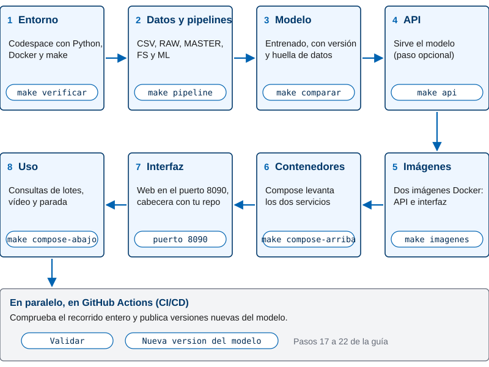
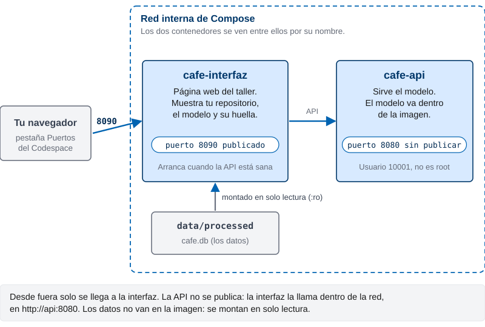
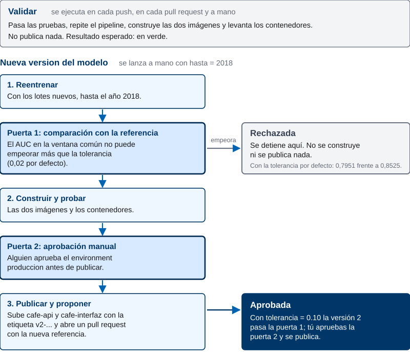

# Instrucciones en breve

## La idea en una página

Tienes que desplegar un servicio de ML que ya está hecho y explicar cómo encaja. No programas nada.

- Recibes: una plantilla de GitHub con el proyecto completo (datos, pipelines, modelo, API, interfaz, Docker y workflows) y un Codespace listo para usarla.
- Haces: un fork de la plantilla, lo despliegas de punta a punta desde el Codespace y, para cada pieza, escribes qué decisión de arquitectura hay detrás y qué riesgo cubre.
- Entregas: un vídeo del servicio funcionando por su interfaz, 16 capturas del proceso, la plantilla de evidencias rellena y tu fork público.
- Cuándo: el lunes 30/11/2026, durante ese día. No hay una hora límite concreta.
- Cómo: envías el enlace de tu fork por un solo canal del curso: el chat del grupo, Google Classroom o el correo del curso.

El caso: llega un lote de café y, antes de catarlo, se quiere saber qué probabilidad hay de que sea café de especialidad (80 puntos o más). Los datos son los del Coffee Quality Institute (CQI).

La plantilla está en `https://github.com/helicr/curso-ml-ia-desarrollo-produccion-tarea`.

Tu fork debe llamarse exactamente `taller-ml-ia-dev-production` y ser público. El instructor te identifica por ese nombre y por tu enlace.

Hay otro PDF, `guia-detallada.pdf`, con el paso a paso completo y capturas de ejemplo. Consúltalo cuando un paso de este documento no te baste.

## El recorrido de punta a punta

Cada caja es un paso y debajo va la orden que lo ejecuta. Todo se hace en el Codespace, salvo abrir la interfaz y grabar el vídeo.

## Las dos piezas en Docker

Son dos contenedores. Solo la interfaz se ve desde fuera, en el puerto 8090. La API queda dentro de la red de Compose.

## CI/CD en GitHub Actions

Nueva version del modelo tiene dos puertas. La primera compara con la referencia y puede rechazar la versión. La segunda es una aprobación manual del environment `produccion`.

En tu fork, GitHub no trae activadas tres cosas, y las activas tú: las Actions (paso 17), el environment `produccion` con tu usuario como revisor (paso 19) y la casilla «Allow GitHub Actions to create and approve pull requests» (paso 19).

## Los pasos

Cada paso con su orden y lo que debes ver. Los pasos 10 y 16 son opcionales.

| Paso | Qué haces | Orden o lugar | Qué ves |
|---|---|---|---|
| 0 | Preparas tu cuenta | GitHub con Codespaces y Actions | Nada que ver aún |
| 1 | Haces el fork | Botón Fork de la plantilla | Tu repositorio, con «forked from ...» |
| 2 | Lo renombras | Settings > General | `.../taller-ml-ia-dev-production` |
| 3 | Creas el Codespace | Code > Codespaces | VS Code en el navegador (unos 4,5 min) |
| 4 | Aceptas los avisos de la primera vez | Codespace | La terminal lista |
| 5 | Verificas el entorno | `make verificar` | «LISTO PARA EL TALLER» |
| 6 | Revisas el proyecto | `make ayuda` | La lista de órdenes |
| 7 | Ejecutas los pipelines | `time make pipeline` | «Mejor modelo», «versión 1» (unos 49 s) |
| 8 | Los repites | `make pipeline` | Cuatro líneas «sin cambios» |
| 9 | Compruebas el modelo | `make comparar` | Cuatro caminos «coincide» |
| 10 | Sirves el modelo | `make api` | La API en el puerto 8080 |
| 11 | Construyes las imágenes | `time make imagenes` | `cafe-api` y `cafe-interfaz` (1 min 18 s) |
| 12 | Levantas los contenedores | `time make compose-arriba` | Los dos contenedores «Healthy» |
| 13 | Abres la interfaz | Pestaña Puertos, puerto 8090 | Cabecera con tu repositorio |
| 14 | Consultas lotes | La interfaz | Resultado con tramos y avisos |
| 15 | Grabas el vídeo y paras | `make compose-abajo` | Contenedores detenidos |
| 16 | Llegan lotes nuevos | `make pipeline HASTA=2018` | Versión 2 del modelo |
| 17 | Habilitas Actions | Pestaña Actions de tu fork | Dos workflows |
| 18 | Lanzas `Validar` | Run workflow | Ejecución en verde (unos 7 min 42 s) |
| 19 | Preparas `produccion` y los permisos | Settings | `produccion` con tu usuario como revisor |
| 20 | Lanzas `Nueva version del modelo` con la tolerancia por defecto | Run workflow, `hasta` = 2018 | Rojo a propósito: «Version rechazada» |
| 21 | La lanzas con `tolerancia` = 0.10 | Run workflow | Esperas, apruebas, se publica (4 min 30 s) |
| 22 | Compruebas paquetes y pull request | Packages y Pull requests | Etiqueta `v2-...` y un pull request |
| 23 | Entregas | `git add evidencias`, `git commit`, `git push` | `evidencias/` en tu fork |

En cada paso añades una frase de arquitectura: qué pieza es y qué riesgo cubre.

## Qué entregas

El vídeo, en `evidencias/video/servicio-en-produccion.mp4`:

- MP4, de 2 a 4 minutos, con tu voz y de menos de 50 MB.
- Debe verse la cabecera de la interfaz con tu repositorio, los contenedores sanos, una consulta de lotes con su resultado y los avisos.
- Debes explicar la arquitectura con tus palabras.

Las 16 capturas, en `evidencias/capturas/`, con estos nombres (el número es el paso de la guía):

| Captura | Paso | Captura | Paso |
|---|---|---|---|
| `01-fork-renombrado` | 2 | `09-puerto-8090` | 13 |
| `02-codespace-abierto` | 3 | `10-ui-cabecera` | 13 |
| `03-verificar-entorno` | 5 | `11-ui-resultado` | 14 |
| `04-pipeline` | 7 | `12-validar-verde` | 18 |
| `05-pipeline-sin-cambios` | 8 | `13-environment-produccion` | 19 |
| `06-modelo-version` | 9 | `14-nueva-version-rechazada` | 20 |
| `07-imagenes` | 11 | `15-nueva-version-aprobacion` | 21 |
| `08-compose-sano` | 12 | `16-paquetes-y-pr` | 22 |

La plantilla `evidencias/plantilla-evidencias.md`, rellena: para cada captura, qué muestra y tu explicación de arquitectura.

Las capturas y el vídeo son tuyos, con tu usuario visible. No sirven las capturas de ejemplo de la guía. Si algo no te funcionó, dilo y adjunta la captura del error.

## Cómo se evalúa

| Criterio | Peso |
|---|---|
| Ejecución y reproducibilidad | 40 |
| Evidencias | 30 |
| Comprensión (criterio de arquitecto) | 30 |

La comprensión se evalúa con tus explicaciones de arquitectura, no con código. El detalle de los niveles está en `taller/criterios-de-evaluacion.md`.
